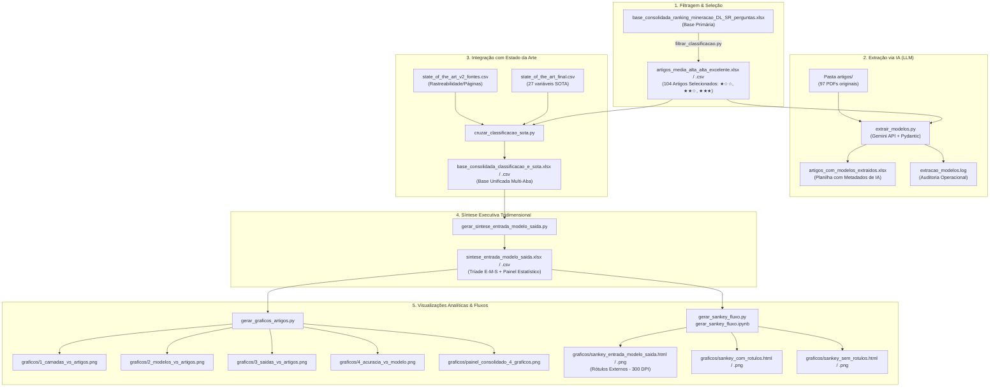

# Manual Operacional: Pipeline de Inteligência e Análise de Artigos Científicos

Este documento é o guia técnico definitivo do repositório **AnaliseArtigos**. Ele descreve toda a arquitetura de dados, pipeline de processamento em múltiplas etapas, catálogo de scripts, especificações das bases de dados, rotinas de visualização analítica (gráficos e Diagrama de Sankey) e soluções de engenharia implementadas para contornar limitações de ambiente e APIs.

---

## 1. Visão Geral e Contexto do Projeto

O projeto tem como escopo a literatura científica aplicada em **Sensoriamento Remoto, Inteligência Artificial (Deep Learning e Machine Learning) e Prospecção Mineral / Geociências**. 

O objetivo central é rastrear e modelar quantitativamente a cadeia metodológica ponta a ponta dos artigos:
1. **Entrada (Dados & Sensores):** Sensores multiespectrais, hiperespectrais, dados geofísicos, geoquímica, VANTs/drones e modelos digitais.
2. **Modelo (Arquiteturas Computacionais):** Redes Convolucionais (1D/2D/3D CNNs), Transformers/ViT, Graph Neural Networks (GCN/GAT), Autoencoders (DAE/VAE), GANs e algoritmos clássicos (Random Forest, SVM, XGBoost).
3. **Saída (Alvos Minerais & Produtos):** Ouro, Cobre (Pórfiro/Skarn), Lítio em pegmatitos, Minério de Ferro, Polimetálicos, Alteração Hidrotermal e Mapeamento Litológico.
4. **Desempenho & Estado da Arte (SOTA):** Métricas de acurácia, F1-Score, OA (Overall Accuracy), limitações reportadas e rastreabilidade de evidências no PDF original.

---

## 2. Diagrama do Pipeline de Execução Ponta a Ponta



---

## 3. Catálogo Completo de Arquivos e Estrutura de Pastas

### 3.1. Scripts de Automação e Processamento (.py)

| Script | Função Principal | Entradas | Saídas |
| :--- | :--- | :--- | :--- |
| [filtrar_classificacao.py](file:///c:/Users/Luisl/OneDrive/Documentos/GitHub/AnaliseArtigos/filtrar_classificacao.py) | Filtra a planilha bruta original para isolar os 104 artigos de maior relevância (`Média-Alta ★☆☆`, `Alta ★★☆` e `Excelente ★★★`). | `base_consolidada_ranking_mineracao_DL_SR_perguntas.xlsx` | `artigos_media_alta_alta_excelente.xlsx`, `artigos_media_alta_alta_excelente.csv` |
| [extrair_modelos.py](file:///c:/Users/Luisl/OneDrive/Documentos/GitHub/AnaliseArtigos/extrair_modelos.py) | Processa cada PDF na pasta `artigos/` enviando para a API do Google Gemini com saída estruturada Pydantic. Possui checkpoint contínuo e tratamento de cotas. | `artigos_media_alta_alta_excelente.xlsx`, PDFs em `artigos/` | `artigos_com_modelos_extraidos.xlsx`, `extracao_modelos.log` |
| [cruzar_classificacao_sota.py](file:///c:/Users/Luisl/OneDrive/Documentos/GitHub/AnaliseArtigos/cruzar_classificacao_sota.py) | Realiza o matching difuso entre os 104 artigos selecionados e as bases de Estado da Arte (27 variáveis e páginas de evidência). | `artigos_media_alta_alta_excelente.xlsx`, `state_of_the_art_final.csv`, `state_of_the_art_v2_fontes.csv` | `base_consolidada_classificacao_e_sota.xlsx`, `base_consolidada_classificacao_e_sota.csv` |
| [gerar_sintese_entrada_modelo_saida.py](file:///c:/Users/Luisl/OneDrive/Documentos/GitHub/AnaliseArtigos/gerar_sintese_entrada_modelo_saida.py) | Harmoniza os dados em 3 blocos temáticos coloridos (Entrada, Modelo, Saída), gerando aba executiva, matriz completa e rankings estatísticos. | `base_consolidada_classificacao_e_sota.csv` | `sintese_entrada_modelo_saida.xlsx`, `sintese_entrada_modelo_saida.csv` |
| [gerar_graficos_artigos.py](file:///c:/Users/Luisl/OneDrive/Documentos/GitHub/AnaliseArtigos/gerar_graficos_artigos.py) | Produz 4 gráficos estatísticos analíticos individuais e compõe o painel consolidado 2x2 em estilo executivo (300 DPI). | `sintese_entrada_modelo_saida.csv` | `graficos/1_camadas_vs_artigos.png`, `graficos/2_modelos_vs_artigos.png`, `graficos/3_saidas_vs_artigos.png`, `graficos/4_acuracia_vs_modelo.png`, `graficos/painel_consolidado_4_graficos.png` |
| [gerar_sankey_fluxo.py](file:///c:/Users/Luisl/OneDrive/Documentos/GitHub/AnaliseArtigos/gerar_sankey_fluxo.py) | Constrói o Diagrama de Sankey tridimensional (Entrada ➔ Modelo ➔ Saída) com conservação de fluxo, aproximação de colunas (70%), rótulos nos extremos externos e exportação interativa/estática. | `sintese_entrada_modelo_saida.csv` | `graficos/sankey_entrada_modelo_saida.html`, `graficos/sankey_entrada_modelo_saida.png`, versões com e sem rótulos |

---

### 3.2. Notebooks Interativos (.ipynb)

| Notebook | Função |
| :--- | :--- |
| [gerar_sankey_fluxo.ipynb](file:///c:/Users/Luisl/OneDrive/Documentos/GitHub/AnaliseArtigos/gerar_sankey_fluxo.ipynb) | Versão modular em Jupyter Notebook do fluxo Sankey, dividida em blocos executáveis com documentação de células e inspeção interativa imediata no ambiente Jupyter/VS Code. |

---

### 3.3. Bases de Dados e Planilhas (.xlsx e .csv)

| Arquivo | Registros | Descrição e Estrutura |
| :--- | :--- | :--- |
| [base_consolidada_ranking_mineracao_DL_SR_perguntas.xlsx](file:///c:/Users/Luisl/OneDrive/Documentos/GitHub/AnaliseArtigos/base_consolidada_ranking_mineracao_DL_SR_perguntas.xlsx) | ~200+ artigos | Base bruta original com todas as triagens, perguntas metodológicas, rankings e scores de relevância. |
| [artigos_media_alta_alta_excelente.xlsx](file:///c:/Users/Luisl/OneDrive/Documentos/GitHub/AnaliseArtigos/artigos_media_alta_alta_excelente.xlsx) | 104 artigos | Base filtrada contendo apenas artigos de nível alto/excelente. Formatação visual com destaque em estrelas. |
| [artigos_media_alta_alta_excelente.csv](file:///c:/Users/Luisl/OneDrive/Documentos/GitHub/AnaliseArtigos/artigos_media_alta_alta_excelente.csv) | 104 artigos | Versão em CSV UTF-8 com BOM (separador `;`) da base de 104 artigos. |
| [state_of_the_art_final.csv](file:///c:/Users/Luisl/OneDrive/Documentos/GitHub/AnaliseArtigos/state_of_the_art_final.csv) | 96 artigos | Tabela analítica com 27 atributos técnicos detalhados (algoritmos base, sensores, alvos, métricas de validação e limitações). |
| [state_of_the_art_v2_fontes.csv](file:///c:/Users/Luisl/OneDrive/Documentos/GitHub/AnaliseArtigos/state_of_the_art_v2_fontes.csv) | 97 artigos | Matriz de rastreabilidade de evidências com citação de números de páginas, seções e figuras dentro de cada PDF. |
| [artigos_com_modelos_extraidos.xlsx](file:///c:/Users/Luisl/OneDrive/Documentos/GitHub/AnaliseArtigos/artigos_com_modelos_extraidos.xlsx) | 104 artigos | Planilha resultante da extração automática pelo Gemini contendo o Modelo Principal, Baselines comparados, Sensores e Trechos literais de evidência. |
| [base_consolidada_classificacao_e_sota.xlsx](file:///c:/Users/Luisl/OneDrive/Documentos/GitHub/AnaliseArtigos/base_consolidada_classificacao_e_sota.xlsx) | 104 artigos | Planilha multi-aba consolidada: (1) Dados completos cruzados, (2) Resumo estatístico por faixa de estrela e (3) Rastreabilidade de páginas. |
| [base_consolidada_classificacao_e_sota.csv](file:///c:/Users/Luisl/OneDrive/Documentos/GitHub/AnaliseArtigos/base_consolidada_classificacao_e_sota.csv) | 104 artigos | Exportação consolidada tabular única com delimitador `;` em UTF-8 com BOM. |
| [sintese_entrada_modelo_saida.xlsx](file:///c:/Users/Luisl/OneDrive/Documentos/GitHub/AnaliseArtigos/sintese_entrada_modelo_saida.xlsx) | 104 artigos | Planilha executiva com abas: (1) Síntese Executiva E-M-S, (2) Matriz Completa com blocos coloridos e (3) Painel Estatístico de frequências. |
| [sintese_entrada_modelo_saida.csv](file:///c:/Users/Luisl/OneDrive/Documentos/GitHub/AnaliseArtigos/sintese_entrada_modelo_saida.csv) | 104 artigos | Versão CSV padronizada utilizada como entrada direta para os scripts de geração gráfica e Sankey. |

---

### 3.4. Diretórios de Apoio e Artefatos

* [artigos/](file:///c:/Users/Luisl/OneDrive/Documentos/GitHub/AnaliseArtigos/artigos): Pasta contendo **97 arquivos em formato PDF** em texto completo, correspondentes aos artigos analisados no estudo.
* [graficos/](file:///c:/Users/Luisl/OneDrive/Documentos/GitHub/AnaliseArtigos/graficos): Pasta com as saídas visuais geradas pelos scripts:
  * [1_camadas_vs_artigos.png](file:///c:/Users/Luisl/OneDrive/Documentos/GitHub/AnaliseArtigos/graficos/1_camadas_vs_artigos.png): Ranking de sensores e fontes de dados.
  * [2_modelos_vs_artigos.png](file:///c:/Users/Luisl/OneDrive/Documentos/GitHub/AnaliseArtigos/graficos/2_modelos_vs_artigos.png): Distribuição das arquiteturas de IA/DL/ML.
  * [3_saidas_vs_artigos.png](file:///c:/Users/Luisl/OneDrive/Documentos/GitHub/AnaliseArtigos/graficos/3_saidas_vs_artigos.png): Objetos geológicos e minerais prospectados.
  * [4_acuracia_vs_modelo.png](file:///c:/Users/Luisl/OneDrive/Documentos/GitHub/AnaliseArtigos/graficos/4_acuracia_vs_modelo.png): Dispersão e acurácia média por família de modelos.
  * [painel_consolidado_4_graficos.png](file:///c:/Users/Luisl/OneDrive/Documentos/GitHub/AnaliseArtigos/graficos/painel_consolidado_4_graficos.png): Painel unificado 2x2 de alta resolução.
  * [sankey_entrada_modelo_saida.html](file:///c:/Users/Luisl/OneDrive/Documentos/GitHub/AnaliseArtigos/graficos/sankey_entrada_modelo_saida.html): Diagrama de Sankey interativo com **rótulos externos nos extremos**.
  * [sankey_entrada_modelo_saida.png](file:///c:/Users/Luisl/OneDrive/Documentos/GitHub/AnaliseArtigos/graficos/sankey_entrada_modelo_saida.png): Versão estática a 300 DPI do Sankey com rótulos externos.
  * [sankey_com_rotulos.html](file:///c:/Users/Luisl/OneDrive/Documentos/GitHub/AnaliseArtigos/graficos/sankey_com_rotulos.html) / [sankey_com_rotulos.png](file:///c:/Users/Luisl/OneDrive/Documentos/GitHub/AnaliseArtigos/graficos/sankey_com_rotulos.png): Cópia espelho da versão com rótulos externos.
  * [sankey_sem_rotulos.html](file:///c:/Users/Luisl/OneDrive/Documentos/GitHub/AnaliseArtigos/graficos/sankey_sem_rotulos.html) / [sankey_sem_rotulos.png](file:///c:/Users/Luisl/OneDrive/Documentos/GitHub/AnaliseArtigos/graficos/sankey_sem_rotulos.png): Versão minimalista sem texto nos nós (foco nas fitas e interação por *hover*).

---

## 4. Arquitetura e Engenharia do Diagrama de Sankey

O script [gerar_sankey_fluxo.py](file:///c:/Users/Luisl/OneDrive/Documentos/GitHub/AnaliseArtigos/gerar_sankey_fluxo.py) foi projetado com soluções matemáticas e visuais avançadas:

### 4.1. Conservação Ponderada de Volume por Artigo
Para que artigos que utilizam múltiplos sensores, modelos ou produtos não distorçam a base total (N = 104 artigos), o algoritmo aplica uma ponderação unitária:
$$\text{peso}_{in \to mod} = \frac{1.0}{|C| \times |M|}, \quad \text{peso}_{mod \to out} = \frac{1.0}{|M| \times |S|}$$
Onde $|C|$, $|M|$ e $|S|$ são o número de camadas, modelos e saídas identificados no artigo. Dessa forma, a soma total dos fluxos que entram no sistema é idêntica à soma que sai, preservando exatamente os 104 artigos equivalentes.

### 4.2. Aproximação das Colunas e Abertura dos Extremos
Por padrão, o Plotly afasta as 3 colunas para as extremidades (`domain.x = [0.0, 1.0]`). O parâmetro `proximidade_colunas = 0.70` encurta a distância entre as colunas centralizando o diagrama no espaço `[0.15, 0.85]`. Isso cria uma margem livre de 15% na esquerda e 15% na direita.

### 4.3. Rótulos Externos nos Nós dos Extremos (Inovação Técnica)
No Plotly Sankey nativo, os rótulos da coluna 1 (Entrada) são desenhados para a direita dos blocos (sobre as fitas) e os da coluna 3 (Saída) são desenhados para a esquerda (também sobre as fitas). 
A solução implementada utiliza injeção de script pós-renderização (`post_script`) associada a `plotly_afterplot` e `MutationObserver`:
- **Coluna da Esquerda (`ENTRADA`):** Localiza os nós em $x_{min}$, ajusta `text-anchor="end"` e translada a coordenada para `x = -8px` (posicionado externamente à esquerda).
- **Coluna da Direita (`SAÍDAS`):** Localiza os nós em $x_{max}$, ajusta `text-anchor="start"` e translada para `x = largura + 8px` (posicionado externamente à direita).
- **Coluna Central (`MODELOS`):** Permanece internamente, mantendo leitura equilibrada.
- **Limpeza de Prefíxos:** Os rótulos exibem os nomes puros dos sensores e alvos (ex: `ASTER (SWIR/TIR)`, `Prospecção Mineral Geral`), enquanto o `customdata` preserva `[Entrada]` e `[Saída]` nos tooltips flutuantes de *hover*.

### 4.4. Exportador Headless de Alta Fidelidade (Playwright + Kaleido Fallback)
Para assegurar que o arquivo estático PNG reflita perfeitamente as alterações dos rótulos externos, a função `exportar_sankey_png`:
1. Inicializa o Chromium headless via `playwright` com `device_scale_factor=2.5` (resolução gráfica de 2700 x 1950 pixels, equivalente a 300 DPI de impressão).
2. Carrega a página HTML já pós-processada e aguarda a estabilização dos nós.
3. Captura o screenshot pixel-perfect sem depender das limitações do motor SVG nativo do Kaleido.
4. Possui fallback automático para `fig.write_image` caso a biblioteca Playwright não esteja presente.

---

## 5. Resolução de Desafios Técnicos e Boas Práticas

### 5.1. Rate Limit 429 (`RESOURCE_EXHAUSTED`) na API do Gemini
* **Causa:** Artigos em PDF contêm entre 15.000 e 50.000 tokens. O processamento rápido em sequência estourou as cotas de tokens por minuto (TPM) da Google API.
* **Solução:** Implementado mecanismo de espera adaptativo. Ao receber código `429`, o script aguarda **65 segundos** (tempo suficiente para que a janela móvel de 60 segundos do Google seja completamente reiniciada) antes de retentar. Intervalo padrão entre chamadas bem-sucedidas ajustado para `6.0s`.

### 5.2. Erro de Encoding no Windows (`'ascii' codec can't encode character '\u2013'`)
* **Causa:** Arquivos científicos frequentemente possuem caracteres Unicode como en-dash `–` (`\u2013`) ou espaços não-separáveis `\xa0`. A biblioteca `google-genai` codifica nomes de arquivos no cabeçalho HTTP `Content-Disposition` em ASCII estrito.
* **Solução:** Criação de cópias temporárias com nome exclusivamente ASCII sanitizado (`gemini_doc_XXXXX.pdf`) para o envio à nuvem, deletando-as imediatamente após a resposta.

### 5.3. Limitação de Caminhos Longos no Windows (`MAX_PATH = 260`)
* **Causa:** Títulos acadêmicos extensos no sistema de arquivos do Windows ultrapassavam 260 caracteres totais, disparando erro de arquivo inexistente (`WinError 3`).
* **Solução:** Aplicação da função `normalizar_caminho_windows`, que anexa o prefixo `\\?\` em caminhos absolutos, ampliando o limite do Windows para 32.767 caracteres.

### 5.4. Exportação CSV com Acentuação no Excel (UTF-8 com BOM)
* **Causa:** Arquivos CSV gerados em UTF-8 puro no Windows abrem desconfigurados no Microsoft Excel padrão brasileiro (caracteres quebrados como `ção`).
* **Solução:** Todos os scripts gravam CSVs com encoding `utf-8-sig` (adicionando Byte Order Mark `\ufeff`) e delimitador `;`, garantindo que abram com acentuação correta e colunas separadas automaticamente no Excel.

---

## 6. Guia Prático de Execução (PowerShell)

### Passo 1: Filtrar Artigos Selecionados
```powershell
python filtrar_classificacao.py
```
*Gera `artigos_media_alta_alta_excelente.xlsx` e `.csv` a partir da base original.*

### Passo 2: Extrair Modelos dos PDFs com o Gemini (Opcional se já extraído)
```powershell
# Configurar chave da API
$env:GEMINI_API_KEY="SUA_CHAVE_AQUI"

# Executar extração com checkpoint contínuo
python extrair_modelos.py
```
*Acompanhar logs com `Get-Content extracao_modelos.log -Tail 20 -Wait`.*

### Passo 3: Cruzar Classificação com Estado da Arte (SOTA)
```powershell
python cruzar_classificacao_sota.py
```
*Gera `base_consolidada_classificacao_e_sota.xlsx` e `.csv` integrando as 27 variáveis do SOTA.*

### Passo 4: Gerar Síntese Entrada-Modelo-Saída
```powershell
python gerar_sintese_entrada_modelo_saida.py
```
*Gera `sintese_entrada_modelo_saida.xlsx` e `.csv` estruturados por cor e prontos para relatórios.*

### Passo 5: Gerar Gráficos Estatísticos e Painel 2x2
```powershell
python gerar_graficos_artigos.py
```
*Gera os 4 gráficos analíticos individuais e o painel consolidado em `graficos/`.*

### Passo 6: Gerar Diagrama de Sankey com Rótulos Externos
```powershell
python gerar_sankey_fluxo.py
```
*Gera os arquivos HTML e PNG (alta resolução) do Diagrama de Sankey na pasta `graficos/`.*

---

## 7. Dicionário de Dados Resumido

### 7.1. Síntese Entrada-Modelo-Saída (`sintese_entrada_modelo_saida.csv`)

| Campo | Descrição | Exemplos |
| :--- | :--- | :--- |
| `ID: Título do Artigo` | Título completo normalizado do artigo | *"A deep residual convolutional neural network..."* |
| `SÍNTESE: Entrada` | Resumo padronizado dos dados e sensores de entrada | *Hiperespectral (PRISMA/AVIRIS), ASTER (SWIR/TIR), Geoquímica* |
| `SÍNTESE: Modelo` | Resumo da arquitetura computacional principal | *Redes Convolucionais (CNNs), Transformers / ViT, U-Net* |
| `SÍNTESE: Saída` | Resumo do alvo ou objetivo prospectivo | *Cobre (Pórfiro/Skarn), Mapeamento Litológico, Ouro* |
| `MODELO: Tipo Algoritmo` | Classificação do algoritmo central | *Deep Learning (Supervisionado), Machine Learning Clássico* |
| `MODELO: Modelos Comparados` | Baselines de comparação utilizados no trabalho | *SVM, Random Forest, MLP, ResNet-18* |
| `DESEMPENHO: Métrica` | Métrica primária de validação reportada | *Overall Accuracy (OA), F1-Score, AUC-ROC* |
| `DESEMPENHO: Valor` | Valor quantitativo da métrica principal | *94.5%, 0.92, 0.88* |
| `CLASSIFICAÇÃO: Estrelas` | Faixa de avaliação metodológica atribuída | *★★★ Excelente, ★★☆ Alta, ★☆☆ Média-Alta* |

---

## 8. Principais Rotas Metodológicas Identificadas na Literatura

A análise dos 104 artigos revelou as rotas metodológicas mais recorrentes na literatura recente:

1. **Hiperespectral (PRISMA/AVIRIS)** ➔ **Redes Convolucionais (CNNs)** ➔ **Prospecção Mineral Geral** (10.50 eq. artigos)
2. **Satélite Convencional** ➔ **Transformers / ViT** ➔ **Prospecção Mineral Geral** (7.33 eq. artigos)
3. **Hiperespectral (PRISMA/AVIRIS)** ➔ **Transformers / ViT** ➔ **Prospecção Mineral Geral** (6.25 eq. artigos)
4. **Satélite Convencional** ➔ **Redes Convolucionais (CNNs)** ➔ **Prospecção Mineral Geral** (3.83 eq. artigos)
5. **Hiperespectral (PRISMA/AVIRIS)** ➔ **Redes Convolucionais (CNNs)** ➔ **Mapeamento Litológico** (3.50 eq. artigos)
6. **Hiperespectral (PRISMA/AVIRIS)** ➔ **Machine Learning Clássico** ➔ **Mapeamento Litológico** (2.92 eq. artigos)
7. **ASTER (SWIR/TIR)** ➔ **Redes Convolucionais (CNNs)** ➔ **Prospecção Mineral Geral** (2.83 eq. artigos)
8. **Radar SAR** ➔ **Transformers / ViT** ➔ **Prospecção Mineral Geral** (2.58 eq. artigos)
9. **Radar SAR** ➔ **Redes Convolucionais (CNNs)** ➔ **Prospecção Mineral Geral** (2.50 eq. artigos)
10. **ASTER (SWIR/TIR)** ➔ **Redes Convolucionais (CNNs)** ➔ **Ouro (Orogênico/Epitermal)** (2.50 eq. artigos)
